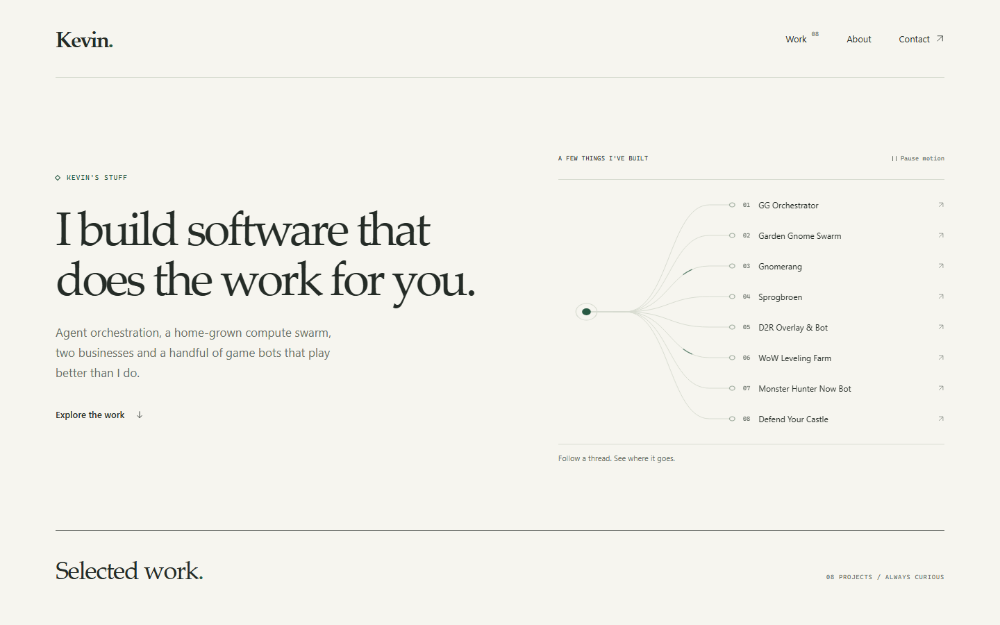
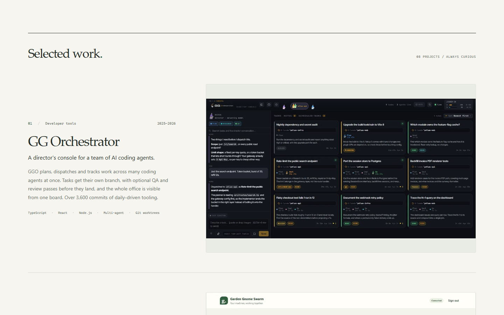
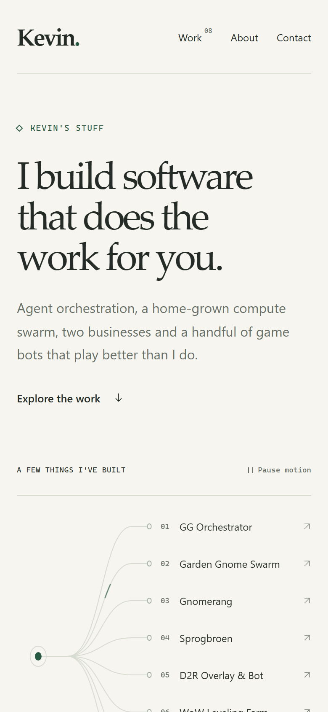

# kevinsstuff.com

Kevin's portfolio: a short, quiet tour of the things he builds — an AI agent orchestrator, a home compute swarm, two small businesses and a few game bots. Live at **[kevinsstuff.com](https://kevinsstuff.com)**.



Each project gets a tagline, a few sentences, its tech tags and one short demo: a screenshot or a muted looping clip.





## Stack

- **No framework, no runtime dependencies.** A Node 22 build script (`scripts/build.mjs`) renders `src/` plus the JSON content into static HTML, one hashed stylesheet and one small script in `dist/`.
- **Content is data.** Projects live in `content/projects.json`, the name, about and contact copy in `content/site.json`, demo media in `public/media/<slug>/`. Editing the site's words never touches code.
- **Small on purpose.** The whole first visit is about 1.1 MB, almost all of it demo media (WebP screenshots and one short MP4); the HTML, CSS and JS together are under 40 KB. Media below the fold loads lazily.

## Develop

```sh
npm ci              # installs the build-only image metadata reader
npm run check       # validates content and source
npm test            # content and build-output tests
npm run build       # writes dist/
npm run preview -- --port 4173   # serves dist/ at http://localhost:4173
```

## Deploy

Every push to `main` that changes the site deploys it. The workflow is [`.github/workflows/deploy.yml`](.github/workflows/deploy.yml):

1. `npm ci`, `npm run check`, `npm test`, the receiver's own unit tests, then `npm run build`.
2. The build is stamped with `dist/release.json` (commit + build time) and packed into a tarball.
3. The tarball is streamed over SSH with a dedicated deploy key. On the server that key is bound with `restrict,command=` to [`deploy/receive.py`](deploy/receive.py), so it can only hand over a site release — no shell, no forwarding.
4. The receiver unpacks into a new `releases/<commit>` directory, rejecting any entry that isn't a plain file or directory under `dist/`, then swaps the `current` symlink in one atomic rename. If the container doesn't serve the new `release.json`, it flips back to the previous release. The last three releases are kept.
5. [`deploy/verify-live.mjs`](deploy/verify-live.mjs) fetches the public site over HTTPS and checks it serves this exact commit, that every built file matches byte for byte, and that `www.` redirects to the apex.

On the server, a small read-only `nginx:alpine` container ([`deploy/compose.yaml`](deploy/compose.yaml), [`deploy/nginx.conf`](deploy/nginx.conf)) serves the current release. It sits behind the host's existing Caddy reverse proxy, which terminates TLS with Let's Encrypt certificates. That Caddy site block lives in the reverse proxy's own repository, not here.

Docs and README edits don't trigger a deploy.

### One-time setup and key rotation

[`deploy/install.py`](deploy/install.py) is run by the owner from their own machine. It installs the container definition and receiver from the committed `HEAD`, and with `--rotate-key` it issues a new CI deploy key, installs it on the server with its forced command, and stores it as GitHub secrets (`KEVINSSTUFF_DEPLOY_SSH_KEY`, `_TARGET`, `_KNOWN_HOSTS`). Keys are never committed.

## Work board

Open and in-flight work is tracked in [BACKLOG.md](BACKLOG.md).
