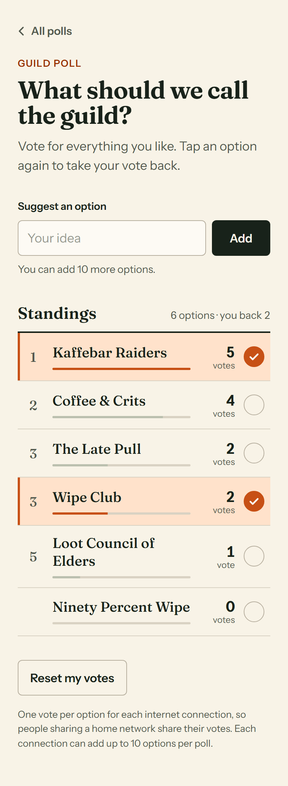
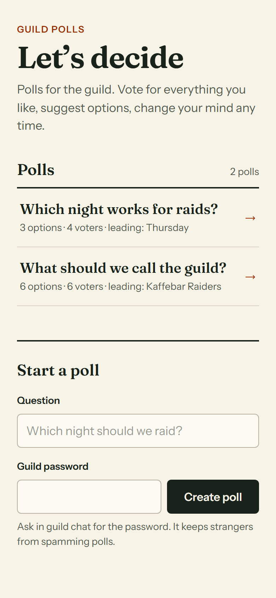
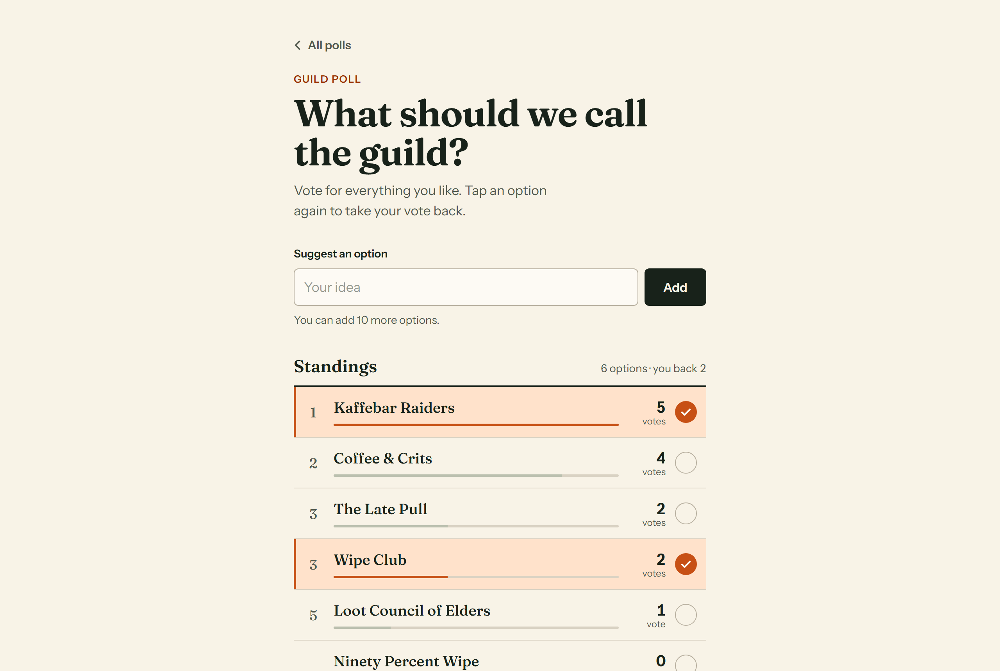
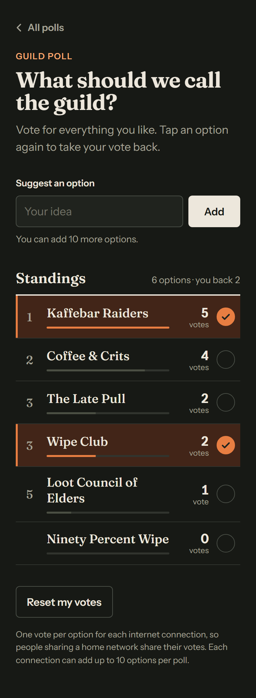

# guildpolls.kevinsstuff.com

Polls for the guild, starting with the one that matters: **what should we call it?** Live at **[guildpolls.kevinsstuff.com](https://guildpolls.kevinsstuff.com)**.

Everyone votes for every option they like, anyone can suggest options, and the standings update on every open phone within a few seconds.

<p>
  
  
</p>





## The rules

All of them are enforced by the server; the page only reflects what the server decided.

- **Approval voting.** Vote for as many options as you like, at most one vote per option. Tap an option again to take your vote back. **Reset my votes** (tap twice to confirm) clears all of your votes in that poll.
- **One identity per internet connection.** Votes are keyed on the client's real IP address: the full address for IPv4, the /64 network for IPv6, because one home connection gets a whole /64 and could otherwise rotate addresses to vote again.
- **Suggestions.** Anyone can add options, up to **10 per connection per poll**. Taking a vote back never refunds the allowance. Names are trimmed, collapsed to single spaces, stripped of invisible characters and limited to 2–40 characters. A name that matches an existing one apart from case or spacing is rejected.
- **New polls need the guild password.** Anyone with the password can start a poll (3–80 character question). Five wrong guesses from one connection lock that connection out of poll creation for 15 minutes. The password lives only in the host's `.env`; it is never in this repository.
- **Live standings.** Options are ranked by votes (ties share a rank), your own votes are highlighted, and the page polls every 4 seconds (the poll list every 8). Votes show instantly and are reconciled with the server's answer.

### Known limitation

People behind the same home IP address, such as friends on one Wi-Fi or a household sharing a connection, count as **one voter**: one vote per option between them, and one shared allowance of 10 suggestions. The page says so under the standings. Anything stricter needs accounts, which a guild-name poll doesn't justify.

## How the real client IP is found

The app is never exposed directly. It publishes no host port and is reachable only from the shared Docker network, through the edge Caddy (container `sprogbroen-caddy`, configured in the Sprogbroen repository).

- `TRUSTED_PROXIES=sprogbroen-caddy` is resolved to that container's address and refreshed every 30 seconds.
- `X-Forwarded-For` is honoured only when the TCP peer is that trusted address. Even then only the rightmost entry counts, which is the one Caddy appended. Whatever a client wrote further left is ignored.
- `X-Real-IP`, `CF-Connecting-IP` and `Forwarded` are never trusted. The site is not behind Cloudflare or the gnomerang tunnel; it is served by Caddy directly.
- Addresses are stored as `HMAC-SHA256(salt, address)`, never in plain text. The 32-byte salt is generated on first start and kept in the data volume (`/data/voter-salt`).

Verified live on 2026-11-03:
- **Two connections are two voters.** A job on the ggs-aws-01 compute worker and a desktop at home voted on the same option, which then showed 2 votes. The worker could add an option while the desktop's allowance was used up.
- **Forged headers change nothing.** The worker then voted with `X-Forwarded-For`, `X-Real-IP`, `CF-Connecting-IP` and `Forwarded` all naming the desktop's address. The vote still counted as the worker's own. The desktop sending the same forged headers kept its own identity.

## Stack

- **Node 22, no dependencies.** `node:http` plus the built-in `node:sqlite` (WAL mode); tests use `node --test`.
- **Plain HTML, CSS and JS** in `public/`, no build step. The page is a small history-API app: `/` lists polls, `/p/<id>` shows one.
- **Fonts:** Fraunces for headings and Instrument Sans for text, self-hosted under the SIL Open Font License (`public/fonts/`).
- **Hardening:**
  - Strict Content-Security-Policy, with all user text rendered via `textContent`.
  - Mutations must come from the same origin, and bodies are capped at 4 KB.
  - Each connection is limited to 40 changes (votes, suggestions, resets, new polls) per 10 seconds.
  - The container runs read-only, as the `node` user, with every Linux capability dropped and a 128 MB memory cap.

| Path | What it holds |
| --- | --- |
| `src/server.js` | HTTP routes, same-origin and rate checks, static files |
| `src/store.js` | SQLite schema and every poll rule (votes, allowance, duplicates) |
| `src/client-ip.js` | Trusted-proxy handling and the IPv4 / IPv6-/64 identity |
| `src/identity.js` | Salt and the HMAC voter id |
| `src/poll-password.js` | Password check and lockout |
| `src/names.js` | Name and title cleaning, the duplicate key |
| `src/backup.js` | Database snapshot, keeps the newest 10 |
| `public/` | The page |
| `deploy/` | Release receiver and owner installer |

## Develop

```sh
cd apps/guildpolls
npm test                                              # 54 tests: rules, IP handling, HTTP API, password lockout
python -m unittest discover -s deploy -p 'test_*.py'  # release receiver (Linux or WSL: it uses fcntl)
GUILDPOLLS_POLL_PASSWORD=dev DATA_DIR=./data PORT=5173 npm start
```

Locally there is no trusted proxy, so every browser tab is the same voter. To simulate several people, start with `TRUSTED_PROXIES=127.0.0.1` and send a different `X-Forwarded-For` per client.

## Deploy

Pushes to `main` that touch `apps/guildpolls/` run [`.github/workflows/guildpolls.yml`](../../.github/workflows/guildpolls.yml):

1. Run the app tests and the receiver tests.
2. Pack `package.json`, `src/` and `public/` with a `release.json` naming the commit.
3. Stream the archive over SSH with the `GUILDPOLLS_DEPLOY_*` key. On the host that key is pinned with `restrict,command=` to [`deploy/receive.py`](deploy/receive.py), so all it can do is hand over a release.
4. The receiver:
   - rejects any entry outside those paths, and any link;
   - snapshots the live database into `/data/backups`;
   - builds the image with the Dockerfile pinned on the host (a release cannot bring its own);
   - switches `guildpolls:live` over and checks that `/api/health` reports the new commit;
   - rolls back to the previous image if it doesn't;
   - keeps the newest three release images.
5. The workflow then fetches `https://guildpolls.kevinsstuff.com/api/health` and requires the pushed commit.

Votes live in the named volume `guildpolls-data`, so restarts and redeploys keep them.

**Owner setup and changes** use [`deploy/install.py`](deploy/install.py) with the owner's SSH key:

```sh
python deploy/install.py                # copy compose.yaml, Dockerfile and the receiver from the committed HEAD
python deploy/install.py --rotate-key   # also issue a new CI key and set the GUILDPOLLS_DEPLOY_* secrets
```

Set `GUILDPOLLS_POLL_PASSWORD` in the environment first to set or change the guild password. Without it, the host keeps the password it already has.

### Restore a backup

```sh
ssh deploy@77.42.40.176
docker exec guildpolls ls /data/backups
docker stop guildpolls
docker run --rm --user root --entrypoint sh -v guildpolls-data:/data guildpolls:live -c 'cp /data/backups/<file>.sqlite /data/guildpolls.sqlite && rm -f /data/guildpolls.sqlite-wal /data/guildpolls.sqlite-shm && chown 1000:1000 /data/guildpolls.sqlite'
docker start guildpolls
```
